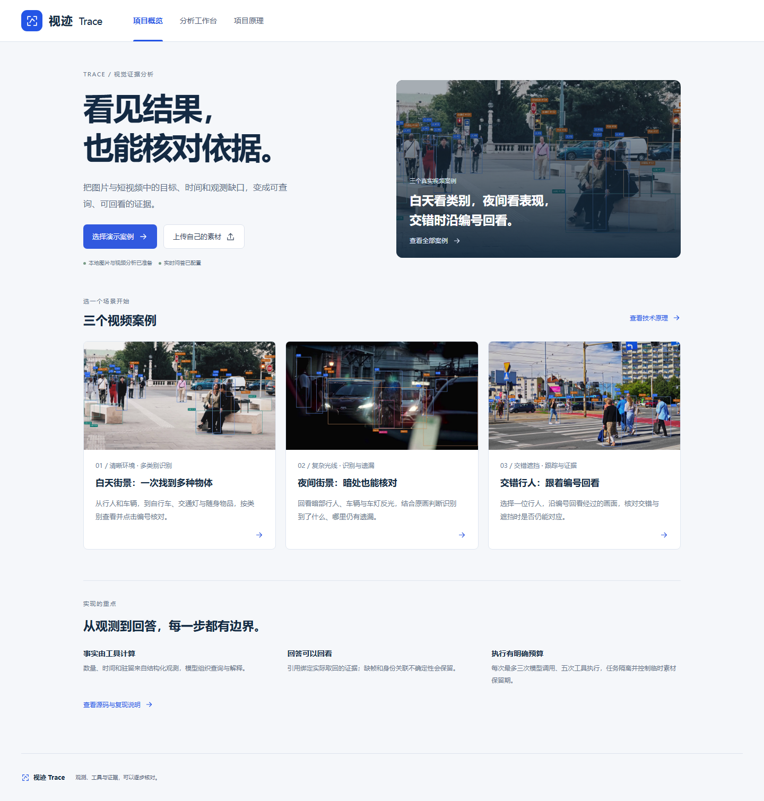

# 视迹 Trace · 可追溯视觉分析 Agent

从视频里定位相关片段，回看实际画面，记录核对结果，再保存带截图的证据单；也支持图片与短视频的真实识别及问答。

**Vue 3 · FastAPI · LangGraph · YOLO11 · ByteTrack · OSNet**

**[下载完整版 · Windows x64](https://github.com/tankangyi154-web/trace-vision-agent/releases/latest/download/Trace-Windows-x64-Full.zip)** · [查看发行说明与全部下载](https://github.com/tankangyi154-web/trace-vision-agent/releases/latest)

完整解压后双击`启动便携版.cmd`。内置Python、前端、CPU识别模型和FFmpeg，无需安装开发环境或填写问答配置；可上传自己的图片和最长2分钟视频，保留本机识别记录，再围绕编号提问。新的Agent问答需要联网，每份体验身份共10次，云端全站每天100次、每月1000次；一次问答最多三轮模型调用，只计一次问答。识别及已有结果回看不受问答次数限制。

适用Windows10/11 x64；启动会自检原生运行库，个别电脑可能需按提示安装微软官方组件。CPU耗时取决于硬件与素材，不能承诺所有电脑同速。仓库的“Code → Download ZIP”用于阅读/开发，直接体验请选择上面的**完整版**。



**先看效果：** 首页提供白天多类别街景、夜间复杂光线、交错行人跟踪三个真实视频案例。打开即查看已完成的识别、编号和证据，无需密钥、GPU或重新分析；也可上传自己的素材。当前尚未提供公网演示 URL。

**发给面试官：** 使用上方完整版即可上传和提问；只看效果可用较小的离线案例包，双击`index.html`，断网也能回看。两个包均不含开发者密钥或用户记录；问答密钥作为云端secret保留。[分享版问答服务与用量](docs/shared-agent.md)；[本机识别真实耗时](docs/local-delivery.md)。

GitHub仓库提交源码及公开示例；便携版和离线包适合放在Releases供下载，不要把`work`、模型环境、个人`.env.local`或自己的识别记录提交到仓库。

## 三个公开视频案例

| 案例 | 你可以验证什么 | 本地入口 |
| --- | --- | --- |
| 白天多类别街景 | 8种已检出类别、类别筛选、单帧数量和编号对应 | `/#demo?scene=daylight` |
| 夜间复杂光线 | 原生暗部、车灯与前景遮挡中的检测表现及遗漏 | `/#demo?scene=lowlight` |
| 交错行人跟踪 | 重点行人编号、未识别时段前后截图、时间点回看 | `/#demo?scene=occlusion` |

示例解读由已保存的真实识别记录计算，明确标为预先分析，不冒充实时模型回答；打开示例不会上传文件或调用外部模型。已配置问答的本机环境可创建独立私有副本继续自由提问。刷新保留例内选中编号与播放位置。[来源、实现与核对范围](docs/prepared-examples.md)。

历史船舶、车流和夜间区域案例保留在项目原理中，便于核对早期事件统计与评估。船舶观测缺口的七帧专项复核仍可从 `/#investigation` 进入；自己的图片或短视频使用 `/#assistant`。

首次体验默认展示简短、通俗的回答和可点击的回看时间。内部编号、工具执行和模型用量收进「查看分析过程」；累计出现时间与连续出现时间仍区分，无法确认的部分明确保留。

上传问答会结合当前选中的编号拆解复合问题，短答后可展开逐项依据，点击“看人 #编号”回到对应画面。数量、时刻和时长直接查询程序结果；相同视觉问题可复用本机私有回答。新增34组问题清单契约与真实模型抽检，不将测试通过率称为回答准确率。[实现与实际验证](docs/agent-answer-implementation.md)。

已按用户选择完成AI证据复核：11条历史响应、33处引用，修复短答丢失不确定理由、重复描述和未询问外观扩展。失败案例继续保留；没有真人参与，不称为独立人工评估。[复核结果与边界](docs/ai-evidence-review.md)。

身高增加标准纸张参照，并接入公开样本误差验证：当前Agent在三张作者标注照片上，区间中点平均误差7.57厘米，只有2个区间覆盖标签，仍保留为实验性粗估。另有研究实测头脚坐标的几何基线，结果与Agent分开，不作为产品精度。[数据、失败案例与复现](docs/height-validation.md)。

新示例按物体类别统一颜色，标签同时包含类型与编号；支持类别筛选、只看选中物体、无框原片和全屏。历史区域案例的统计范围默认隐藏，可在播放器下方按需查看。

区域与时长操作收进默认折叠的「统计设置」，修改后点击「重新统计」应用。页面保留当前已生效的范围与时长，显示记录数量的变化；数量不变时说明原因，失败时保留旧结果并提供重试。

三个历史区域案例接入「巡查复核清单」：同一次出现合并为片段，支持按起止时间播放并自动暂停、查看关键截图、保存「已核对／仍无法确认」与说明、导出可离线打开的HTML核对单。数据或规则改变时，人工意见按各自版本隔离。[流程与实际边界](docs/patrol-workflow.md)。

「项目原理」中折叠保留四条真实运行记录，来自 DeepSeek 官方 API，可按需核对回答、工具执行、模型调用数和引用；查看记录不会发起新的模型请求。[查看脱敏记录](web/public/demos/agent-smoke.json)。

本地上传支持图片最多20MB、视频最多200MB且时长不超过2分钟；默认完整处理，也可明确选择时间段，结果标明原片范围和相对时间起点。相同所有者/内容/类别/范围/算法配置再次提交可复用本机结果；识别阶段显示基于实际速度的剩余时间区间。[上传处理说明](docs/local-media.md)。

支持本机GPU加速与失败后直接重试。同一份117秒街景视频在RTX 5060上约65秒完成全部585个采样画面；这是单素材本机实测。[环境准备与耗时记录](docs/upload-performance.md)。

上传识别使用 YOLO11s，普通画面采用960输入，密集短片自动使用1280输入并保留更多画面细节；按类型统一颜色并避让标签，可筛选类型、单独查看物体或切换无框画面。原有三个案例与专项复核保留 YOLO11n 的历史证据。[识别设置与抽检范围](docs/upload-recognition.md)。

视频中的行人跟踪增加本地 OSNet 外观核对，交叠时暂停更新外观特征；关联有歧义时不强行延续原编号。[遮挡串号修复与验证范围](docs/tracking-stability.md)。

密集场景修正了“已经检测到，却因起始画面被遮挡而长期没有编号”的过滤问题。对同一段商业街、相同类别和70个采样画面，平均显示人体框从2.8个增至14.9个；这是本段画面的框数对照，不是准确率。[实现、真实画面与限制](docs/crowd-detection.md)。

## 本项目实现了什么

- **从观测到事实：** 场景与轨迹契约、区域事件、有效观测驻留、规则 BM25 检索、证据索引与回看。数量和时间由程序计算。
- **复核与留证：** 按区域整理片段、边界内播放、人工核对、版本隔离的浏览器记录、带实际截图的离线证据单。程序事实与人工意见分别保留。
- **有界 Agent：** LangGraph 工具循环，每请求最多三次模型调用、五次工具执行；验证本轮已检索证据与结构化声明。显式告知模型剩余执行约束，减少重复取证。
- **真实媒体处理：** 隔离上传任务、指定类别推理、ByteTrack 跟踪、同素材补查、版本化标注与引用。应用密钥不进入视觉子进程。
- **交付约束：** 会话隔离、请求幂等、额度预留、用量记录、取消与临时数据清理；本地 SQLite、生产可选 Upstash。

基础检测器与跟踪器来自开源组件，没有声称自行训练 YOLO。数量与时间读取结构化观测；询问指定编号的外观、衣着或动作时，会挑选实际截图并交给支持图片的模型分析，不上传整段原始视频。[按编号看图分析](docs/target-visual-analysis.md)。

同一句中的“哪位人、哪辆汽车出现最久”和指定编号的外观可分别查询、合并回答；排名由真实采样区间计算，不补算漏检时间。外观呈现与实际性别身份区分；有完整站姿和明确参照时允许带假设的身高粗估，不能当作测量。[多问题覆盖与边界](docs/multi-question-answering.md)。


## 本地启动

本次在 **Windows、Python 3.12、Node.js 24** 上验证。需要联网安装锁定依赖和官方 CPU 模型；无需 GPU。首次视觉环境安装包含 PyTorch，耗时取决于下载速度。

```powershell
.\setup.cmd
.\启动本地.cmd
```

打开 **http://127.0.0.1:8000/**。`setup.ps1` 准备 API、前端、独立视觉环境、固定模型与 FFmpeg，再运行能力检查。已有 `.env.local` 不会被覆盖。

| 模式 | 需要什么 | 能做什么 |
| --- | --- | --- |
| 案例与回放 | API + 前端；可用 `setup.ps1 -SkipVision` | 查看案例、确定性统计与已录制的真实回答 |
| 本地真实视觉 | 默认完整 setup | 上传图片 / 最长两分钟视频并真实推理，无需模型 Key |
| 实时问答 | 联网使用内置问答服务；开发者可选自配供应商 | 发起新的模型查询、补查并返回引用 |

开发者可选自配问答服务：在被 Git 忽略的 `.env.local` 配置自己的 `DEEPSEEK_API_KEY`，然后重启服务。默认模型为 `deepseek-flash`，也保留 Qwen 兼容配置。不要把密钥写入源码、报告或截图。

PowerShell 可显式指定 Python，或复查准备状态：

```powershell
.\setup.ps1 -Python "C:\path\to\python.exe"
.\.venv\Scripts\python.exe scripts/doctor.py --require all
```

`doctor.py` 检查 Python、API 依赖、前端、视觉入口、模型 SHA 与视频编码器，只输出准备状态，不输出配置值。`/api/health` 同样提供分项能力，已配置 Key 不等于每次模型调用都必然成功。

## 测试与真实联调

```powershell
.\.venv\Scripts\python.exe -m pip install -r requirements-dev.txt
.\.venv\Scripts\python.exe -m pytest -q
.\.venv\Scripts\python.exe -m pytest -q vision/test_media.py vision/test_review_gap.py
.\.venv\Scripts\python.exe -m unittest discover -s evals -p test_evaluate.py
npm --prefix web test
npm --prefix web run build
.\.venv\Scripts\python.exe evals/run_agent_eval.py --validate
```

GitHub Actions 运行上述轻量测试、类型检查和构建，不需要私密 Key。需要 OpenCV 的截图回归另用视觉环境运行 `work/vision-env/Scripts/python.exe -m unittest discover -s vision -p test_evidence.py`。

`evals/agent-cases.json` 提供 **三十条开发用例**，覆盖工具选择、引用、能力外问题及对抗输入。默认只校验用例定义，**不会调用模型**。它不是经过独立标注的金标准，也不把合同检查通过率称为语义准确率。

显式运行三个付费真实案例：

```powershell
.\.venv\Scripts\python.exe evals/run_agent_eval.py --live --case H01 --case H02 --case U01 --limit 3
```

失败不自动重试；结果保存在被忽略的 `work/agent-eval/`。使用 `--replay-output web/public/demos/agent-smoke.json` 只会在选定案例全部通过时更新脱敏回放。请人工检查回答语义后再发布。[本轮验证记录](docs/recruiting-validation.md)。

## 关键边界

- 图片最多 20 MiB；短视频最多 200 MiB、两分钟，按五 fps 抽样，最多六百帧；当前权重支持 COCO 八十类，不能任意文本识别。
- 视频的跟踪记录可能重复，不能当作全片唯一物体数。缺帧、镜头移动和关联歧义影响事件判断。
- 容忍规则连通的区间，不等于每帧有证据，更不等于真实身份或物理连续性已确认。
- 原有视觉抽检仅六帧、十三参考框，由开发代理辅助标注，未独立人工复核；不报告泛化 mAP / IDF1 或未经跑测的提升。
- 分析完成后自动保存为本机识别记录，可刷新恢复、切换查看，手动删除才移除；分析新素材会保留旧记录。待分析文件在浏览器暂存三十分钟。[记录与恢复说明](docs/local-records.md)。外观/动作提问会发送选中的目标截图，其他提问使用结构化记录；不会发送整段原始文件、私密访问链接或访问令牌。
- 当前重型视觉 Worker 只在本地开放。公网接收上传需另行设计推理服务与资源隔离；本仓库不宣称已经部署完成。

## 源码导航

| 入口 | 职责 |
| --- | --- |
| `api/agent.py` | 模型与工具预算、执行图、引用校验 |
| `api/media_tools.py` | 当前素材的数量、时间与证据绑定 |
| `api/domain.py` | 区域事件与有效观测时长 |
| `api/investigation_tools.py` | 七帧复核与结构化声明核验 |
| `api/uploads.py` / `api/store.py` | 私有媒体任务、幂等、额度与历史 |
| `vision/analyze_media.py` | 本地检测、跟踪、补查与标注 |
| `scripts/doctor.py` | 启动准备状态检查 |
| `evals/` / `api/tests/` / `web/tests/` | 开发评测与回归测试 |

更详细的 [媒体处理](docs/local-media.md)、[数据契约](docs/contracts.md)、[部署取舍](docs/deployment.md) 和 [视觉复现](docs/vision.md) 保留在 docs。旧版升级记录归档于 [历史说明](docs/history/local-upload-notes.md)。

## 许可与素材

代码采用 AGPL-3.0-or-later，各组件保留原许可证。演示媒体使用其来源声明的 CC BY-SA 4.0，见 [素材来源](docs/sources.md)、[署名](web/public/media/ATTRIBUTION.txt)、[第三方声明](THIRD_PARTY_NOTICES.md) 和 [代码许可](LICENSE)。
