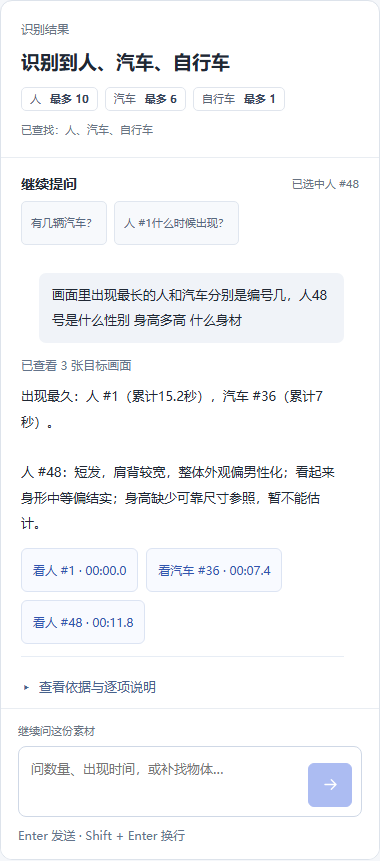

# Agent回答优化：实施与验证

2026-11-03。原方案的查询规划、简洁表达、按问题取图、结果复用与评估工具已经接入本地上传问答。没有更换模型。身高已增加公开数据分层对照，仍为实验能力；用户选择先完成AI复核，该范围已交付，真人评估未进行。

## 体验变化

默认先看到简短结论；点击“查看依据与逐项说明”才展开每项理由和截图。排名、时刻和编号来自程序计算，外观来自该编号的实际截图解读。对应入口显示“看人 #1”“看汽车 #36”，点击后回看并切换到正确对象。

复合问题先形成任务清单，逐项回答或说明具体不足。例如同问人/汽车出现时长、48号外观、体型和身高，分别保留五项。当前选中编号随请求发送，“他穿什么”优先指向这个对象；未选中且历史有多个候选时请求说明编号，不擅自挑人。换素材不继承其他素材的指代。

Enter发送、Shift+Enter换行；中文输入法确认候选字不发送。输入区保持一个外框，发送按钮可点击区域至少44px。



截图复用历史真实DeepSeek事实与视觉解读，按新版短答规则去重；不是新的模型推理。页面交互使用本地测试传输，不产生新的付费调用。

## 实现

| 环节 | 当前行为 | 主要文件 |
| --- | --- | --- |
| 问题清单 | 常见问法直接解析；未知问法先走单独的语义规划，再按白名单校验 | `api/media_plan.py`、`api/agent.py` |
| 对象范围 | 显式编号优先；否则当前选择，再同素材历史；每次最多两个编号、五项查询 | `api/media_plan.py`、`api/store.py` |
| 覆盖检查 | 排名、统计及每个编号各自的方面独立核对 | `api/media_tools.py` |
| 短答 | 从已校验事实生成短答；完整解释、事实来源和引用保留 | `api/media_answer.py`、`MediaAnswer.vue` |
| 问题取证 | 衣着优先细节，身形优先完整画面，动作兼顾前后时刻；每目标至多三张真实画面 | `api/target_frames.py`、`vision/target_frames.py` |
| 编号疑点 | 清晰视图间强烈色彩变化提示核对，不直接证明身份一致或自动换号 | `vision/target_frames.py`、`api/media_tools.py` |
| 直接查询 | 数量、首次出现、时长等使用真实工具结果，模型调用数为零 | `api/agent.py` |
| 重复回答 | 私有记录内保存视觉回答；问题、选择、素材版本、模型及代码版本相同才复用 | `api/answer_cache.py`、`api/uploads.py` |

语义规划阶段与视觉回答阶段使用不同提示，避免真实供应商提前输出答案而没有形成任务清单。模型提出的操作只能是编号详情、类别排名或数量查询；不能猜未指定编号或执行任意操作。已有规则解析出的任务不会被规划覆盖删除。仍限制每次最多三次模型调用、五次工具执行；超出范围的内容明确提示继续问。

衣着、外轮廓、可见姿态按实际画面描述，不需要人物档案。外观呈现与真实性别身份区分。静态图片只描述可见姿态，不证明持续行为。目标太小、模糊、遮挡或参照远近不同分别说明；不凭平均身高填数字。

身高范围只有完整站姿及相近距离的具体参照均可用时才允许提出，尺寸仍是假设，结果标记为非测量。已补充标准纸张参照及[公开数据误差对照](height-validation.md)：Agent照片抽检与研究实测头脚坐标基线分别统计，不能把几何基线精度当作Agent身高精度。[视觉分析边界](target-visual-analysis.md)。

缓存按记录所有者授权读取，补查修订、换对象、问题或模型改变时失效；删除记录同步删除。命中后显示“已复用本机保存的回答”，本次模型/工具次数均为零，不复制旧用量。不重置会话额度，正常提交的问题仍计入既有提问次数。缓存文件不作为媒体资源开放，也不放进源码包。

## 本轮验证及发现

- 178项API回归、88项前端测试、3项视觉取图测试、Vue类型检查和生产构建通过。API测试包含下述34个问题清单用例，不能把这些数字相加当作语义样本数。
- 34组开发者编写的问题清单用例，覆盖同义问法、多问、否定、当前选择、历史歧义、不同编号不同方面、图片、参照尺寸说明和未知请求；全部满足清单契约。它们没有独立人工标注，不代表任意问法的准确率。
- 五类材料：集市近景、低清远景、密集遮挡、公开清晰图片、合成空白阴性对照。既有材料复用真实检测结果，空白对照实际执行检测。
- 独立QA数据库中提交8个初始请求，并复验两处发现的问题，累计9次实际DeepSeek调用，低于用户授权的12次上限。初次“服饰细节”规划失败、“姿态”漏答均保留记录，修复后再次实际返回相应内容。
- 原集市复合问题覆盖人/汽车排名及48号三个外观方面；累计仍为人#1的15.2秒、汽车#36的7秒。短答不列重复限制，完整依据可展开。没有合适身高参照，因此没有输出厘米数。
- 同题重复请求命中私有缓存，0次新增模型/工具调用；空白图数量问题为程序直接查询，0次模型调用。观测到的时间只适用于本机这几个请求，不能视为性能基准。
- 浏览器回放核对默认折叠、五项说明、汽车与人各自证据、回看切换编号、选中编号随Enter提交、刷新恢复及390px/844px布局。使用本地传输夹具，新增模型请求为零。

可复现的零调用检查：

```powershell
python evals/run_media_contracts.py
python -m pytest api/tests -q
```

结果与范围：`evals/media-question-contract-results.json`、`evals/media-answer-spotcheck.json`、`evals/media-answer-browser.json`。真实调用报告不含所有者、素材访问令牌或会话凭据。

这些是开发核验。引用属于本素材的格式检查，不等于已经证明每项视觉解读正确。密集遮挡的串号、未检出、参考物空间关系和语义漏解仍需结合截图核对；没有独立人工语义准确率或用户效率对照。后续身高专项实际调用8次，另有无需模型的实测坐标基线；用量偏差及实验结果均见[身高验证报告](height-validation.md)。

## 按用户选择的交付范围

用户明确选择“暂时没有真人，先完成AI复核”。本轮代码改造、开发验证与AI证据复核已经完成，真人评估保留为可选后续，不冒充已完成的独立人工验收。详见[AI逐项结果与仍存限制](ai-evidence-review.md)。

| 原方案 | 实施状态 | 验证状态 |
| --- | --- | --- |
| 1. 问题清单与指代 | 已接入 | 34组开发契约及接口回归通过 |
| 2. 短答与依据分层 | 已接入 | 浏览器回放与真实回答抽检通过 |
| 3. 按问题取图与编号疑点 | 已接入 | 取图与回看验证通过；不是身份一致性保证 |
| 4. 有条件地推断 | 已接入，身高保持实验能力 | 已完成公开数据分层对照：88组实测坐标基线、3张作者标注照片的真实Agent抽检；不能推广为普通街景测量精度 |
| 5. 回答评估（用户选择AI复核） | AI复核和未签名离线材料已交付 | 11条响应、33处引用；未进行真人独立评估，不报告独立准确率 |
| 6. 直接查询与复用 | 已接入 | 真实直接查询、缓存命中与权限/版本隔离验证通过 |

新增`evals/review_media_answers.py`将独立人工核对与自动回归分开。它统计漏答、事实错误、引用错配、不必要拒答、无依据推断五个方面；未填写的表格不生成通过率，模型自评分不计为独立人工核对。审阅者身份由填写者声明，程序不能证明其真实身份。

身高统计已支持点估计与区间估计，拒答不会被当成零误差。研究实测头脚点基线有88组数值结果，点估计MAE为1.91厘米；Agent三张作者标注照片的区间中点MAE为7.57厘米。二者来源和方法分开，不能混合成产品准确率。单元测试中的合成数字不计入实测材料。

```powershell
# 实测数据基线可计算；独立人工回答核对仍为pending
python evals/review_media_answers.py --catalog evals/ai-review-results.json --height evals/measured-height-validation.json --output evals/media-independent-validation-status.json
# 独立审阅者完成自己的表格、真实测量记录后，再统计
python evals/review_media_answers.py --review path/to/review.json --height path/to/measured-height.json
```

模板为`evals/media-human-review.template.json`和`evals/media-height-validation.template.json`。完整状态见`evals/media-release-readiness.json`。用户选择的AI复核范围已完成，独立真人意见未提供；身高仍有样本和场景限制，不能将几何基线或AI复核当作保证。

## Skill

界面沿用已安装的`ui-ux-pro-max`。通过`find-skills`检索并核对来源后，已安装社区skill [llm-evaluation](https://www.skills.sh/wshobson/agents/llm-evaluation)，采用其自动检查、人工核对与前后对照的评估方法；未引入新的线上评测服务。Skill安装本身不改变模型能力，也不证明回答准确率。
