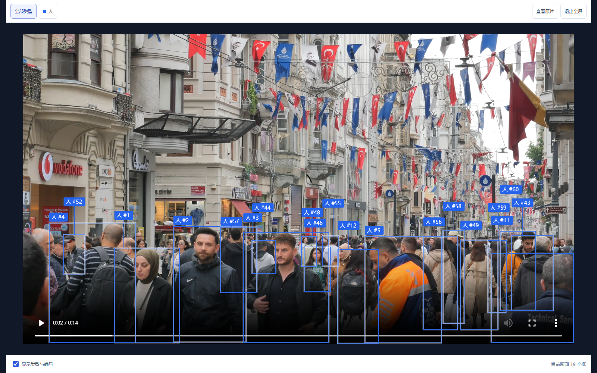

# 密集场景：让已检测到的物体能被保留

用户用4K商业街测试时，大部分近处可见行人没有框。主要问题在关联阶段：初次看到的人已经与他人重叠，没有干净的长期外观档案；旧规则把这种目标后续的关联全部拒绝，连新记录也难以通过第二帧确认。旧检测器每帧平均给出15.8个高置信度人体候选，最终平均仅显示2.8个框。

## 实现

`AppearanceTrack`在没有干净档案时，只保存上次实际画面的临时外观。相邻采样、IoU至少0.5、强检测候选且外观距离不超过0.3，才允许继续确认；颜色不一致及近似平局仍拒绝。临时外观不能跨缺帧重新认领编号，也不会写入长期档案；已存在干净档案的关联规则保持原约束。对应版本为`appearance-gated-v2`。

`MediaDetector`检测到至少12个高置信度行人或24个所选物体后启用密集模式：重叠抑制IoU从0.5调整为0.65，候选上限从60增至200。不超过30秒的视频保留到1920×1080以内并以1280输入检测；竖屏交换长短边。更长的视频保持原尺寸上限和960检测输入。仅模式切换时增加一次复算，不逐帧重复两套检测，不降低新记录0.25门槛，不进行生成式修复。

配置、SHA和实际生效参数写入`processing`。补查校验相同的规范化素材、检测策略与跟踪版本；旧记录可继续回看，需重新上传分析才能获得新版结果，避免静默改变旧编号和截图引用。

## 本次实际对照

来源：[Towfiqu barbhuiya / Pexels](https://www.pexels.com/video/bustling-street-scene-with-flags-and-people-33778196/)，[素材许可](https://www.pexels.com/license/)。原文件3840×2160，14.014秒。对照使用同一输入SHA、相同类别及顺序（人、汽车、自行车）、相同70个采样时刻。

| 比较项 | 原结果 | 新结果 |
| --- | ---: | ---: |
| 平均显示人体框 | 2.76 | 14.93 |
| 单帧最多人体框 | 16 | 25 |
| 2.0秒画面人体框 | 1 | 19 |
| 用于识别的规范化尺寸 | 1280×720 | 1920×1080 |

只修正关联、复用原检测候选时，平均显示11.53个框。完整新版通过真实上传API运行，单次处理约35.6秒。旧作业耗时受到当时机器负载影响，不据此报告速度提升。原40秒路口片也经过完整上传回归：红衣行人12个检查点保持一个编号，没有接到浅色行人身上。

浏览器核对上述同一时刻的真实框数、刷新恢复和390像素宽度下的布局，没有新增上传或付费模型请求。原画面使用已有结果的本地只读快照渲染，新版使用实际API结果；未修改用户原记录。

可检查`evals/crowd-detection-spotcheck.json`中的逐时刻框数和配置。回归另覆盖起始即重叠的多人、第二帧确认、缺帧后不能冒用临时编号、不同衣着不能串号、原合并框拒绝与索引一致性。

这不是独立标注的检测准确率或跟踪指标。更多框本身不能证明全部正确；远处只露出头部、长期重遮挡的人仍会漏检，短时关联中断也可能重新编号。跟踪记录数不能当作全片唯一人数，没有声称支持可靠的密集人流统计。
