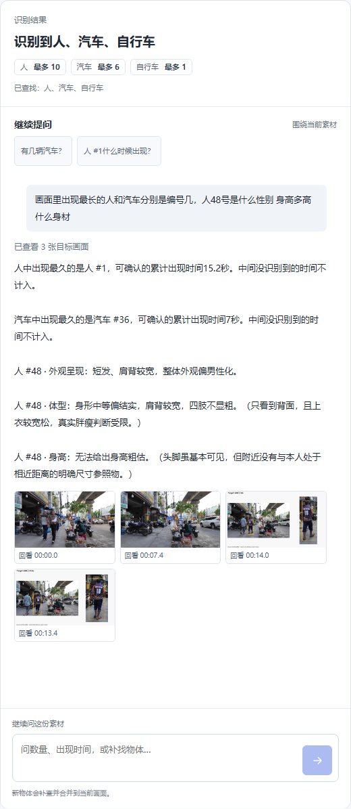

# 上传素材的多问题回答

2026-11-02，修复指定编号的复合问题只返回首次、末次识别时间的情况。原来的查询没有路线或中断摘要，回答提示又偏向只选一两项事实。

后续已补上[真正的目标看图分析](target-visual-analysis.md)。下文最初只查记录的限制现已更新：体型、衣着、姿态等会按实际截图分析，无法判断的项说明具体原因，不再一律回复没有分析能力。

## 当前行为

2026-11-03更新：当前默认将这些方面组织为短答，完整分项、原因和截图收进“查看依据与逐项说明”。新增当前选中编号、同素材指代、语义规划及私有回答缓存；详见[已实施方案与验证](agent-answer-implementation.md)。下列早期验证数字仅表示对应历史轮次，不是当前总测试数。

例如：“人30号什么时候出现，轨迹是什么样，多久消失？性别、身材、身高呢？”回答分六段：

- 出现时间：本次跟踪记录的首次识别时间。
- 大致路线：实际识别框中心在画面中的位置变化。
- 消失情况：末次识别时间、距视频结束的时间差及中途未识别记录；不宣称实际离开或被遮挡。
- 外观呈现：实际取图后描述可见发型、轮廓及整体呈现，不确认实际性别身份。
- 体型：根据实际截图描述可见外轮廓，衣服遮住或目标太小时具体说明限制。
- 身高：清晰完整站姿和相近距离的具体参照均可见时，可给标明参照假设的粗略范围；不足时说明本目标缺少什么。

没有可靠结果的方面也明确回复，不通过省略来掩盖能力边界。图片没有时序，不推断出现时间、移动路线或离开时间。

## 实现与边界

`api/media_profile.py`识别常见中文提问方面和显式编号。明确指定至多两个编号时，执行图在模型推理前实际调用`locate_object`，工具次数计入原有预算，执行记录标记`origin=question_plan`。无编号时可由模型结合当前素材/上下文查询具体对象；不能确定时请用户指定编号。超过两个编号提示分开核对，避免在有限上下文中遗漏。

`locate_object`保留原有首末时间字段，新增真实样本计算的轨迹与未识别摘要、明确的能力限制。画面位置按九宫格概括，过滤短暂位置跳动，最多保留四个代表位置，不插值补全缺失路线。中断长度只记录缺失采样对应的时间，不解释为实际消失、遮挡或在场时长。

`MediaTools`对已识别的子问题逐项检查本轮事实，返回`answer_coverage`。即使模型仅选择首项，也按实际查询结果补齐这些已支持的方面。模型自由文字不能覆盖这些事实。补查失败的提示继续保留；非法事实键、未检索或跨素材引用继续拒绝。首末证据选择该编号实际出现的画面，同帧其他物体的默认排序不改变当前回答对象。

这是一组有界提问方面的完整性检查，不是对任意自然语言复合问题的全面语义理解保证。大致画面路线也不能证明真实身份、目的地、具体动作、真实距离或速度。检测漏检和编号关联仍有局限。

## 全局比较与指定编号混合提问（2026-11-03）

修复“出现最久的人和汽车分别是几号，48号的外观、身高、身材呢”只回答后半句的问题。计划器先分别执行人、汽车的`rank_objects`，再执行48号的`locate_object`，三次真实工具查询在第一次模型调用前完成，仍计入五次工具预算。

排名按相邻实际采样区间累计，不使用首次至末次的跨度填补漏检间隔；明确问连续时比较最长连续识别区间。并列、没有检出、样本缺失和图片无时序分别回答。即使模型的fact_keys漏选比较项，最终覆盖检查仍将本轮实际排名放在编号外观之前。排名与指定编号分别绑定引用，回看汽车证据时会切换到对应汽车，不停留在先前选中的人。

同一份集市记录的实际模型验证：人#1累计15.2秒、汽车#36累计7秒，随后回答48号的外观呈现、体型与身高依据，五项均覆盖。此次48号未提供身高数字：虽有较完整站姿，缺少相近距离的明确尺寸参照；未以缺少正脸或个人档案为由拒绝可见体型分析。[视觉估计与实际验证](target-visual-analysis.md)。

实际结果与边界见`evals/mixed-question-spotcheck.json`。下面是复用这份真实模型输出的浏览器验收画面，未重新调用模型或重跑检测：

## 最初只查记录时的验证

- API回归测试：86项通过，包括原问题的六项覆盖、模型只选首项、缺少/不规则样本、单张图片、无效编号、引用隔离，以及同帧引用对象归属。
- 使用Idiap Traffic Junction公开40秒低清样本重新实际识别，再通过本机HTTP接口向真实DeepSeek供应商提交原问题。返回六项完整回答，1次模型调用、1次实际查询；19秒首次识别，38.4秒末次识别，性别/体型/身高逐项说明不能可靠判断。
- 独立浏览器复用这份真实回答，核对六段显示、上下滚动、证据图打开与定位19秒、390px手机无横向溢出。未追加模型请求，未发现页面脚本错误。

这是针对已发现问题的开发验证，不代表对所有视频或问法的准确率评估。视频来源及使用范围见[第三方说明](../THIRD_PARTY_NOTICES.md)。原始上传、访问令牌、会话标识和供应商密钥不随源码发布。
