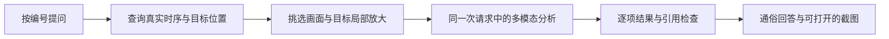

# 按编号提取画面并分析

2026-11-02，替换外观问题一律返回固定能力限制的路径。指定“人 #30穿什么、是什么姿态”等问题后，系统实际提取该编号的原始观测画面，交给支持图片的模型查看；清晰可见的正常描述，模糊或缺少依据的具体说明原因。

## 数据如何流动

1. `MediaTools`识别出现时间、路线、衣着、体型、动作、随身物品等常见提问方面。编号及时间查询仍来自检测记录，不交给图片模型重新猜。
2. `api/target_frames.py`在所有者授权范围内读取本机规范化素材和对应修订的检测结果，调用无应用密钥的独立视觉进程。
3. `vision/target_frames.py`只检查该编号真实存在的样本，最多评估18个候选，结合目标大小、清晰度、框重叠和画面边缘，按时间段挑选最多3张。随机定位后核对真实帧索引，不借用相邻或未来观测。
4. 每张卡片左侧为背景定位、右侧为同一目标局部放大，黄色框明确对象。仅普通缩放，不用生成式补图或宣称恢复丢失细节。清晰度指标只能辅助挑选，噪声和轮廓边缘也可能提高指标，因此仍保留原始目标宽高和图像检查。
5. 卡片以有界JPEG数据放入该次模型请求的user消息；工具日志只记录时间、框、质量、图像哈希和证据ID。模型不接收文件路径、私密资源URL、令牌或整个原始视频。
6. 模型按方面输出`visual_observations`：目标、描述、clear/uncertain/insufficient、具体原因、该目标截图ID。程序检查本轮实际图片引用，并按问题逐项组织回答，页面显示实际查看张数与可打开的截图。

## 模型与预算

本机当前沿用现有DeepSeek密钥及`deepseek-flash`，通过标准Chat Completions的`image_url`数据块传图。[官方图片输入说明](https://api-docs.deepseek.com/guides/vision/)。图片输入合并在原有模型调用中，用量由供应商实际返回，不调用隐藏的第二个视觉服务。

每个请求仍最多3次模型、5次工具。最多查看两个编号、六张JPEG，每张内联数据不超过约1MB，总图像数据有独立上限；原有40,000字符文字上下文预算不被base64占用，也不因此失效。图片只在user消息中发送。Qwen兼容配置需选择支持图片的VL模型；不支持图片的配置不会假装看过画面。

## 判断边界

- 衣着、颜色、姿态、持物和外轮廓：实际可见就描述，部分不清楚则区分可见内容与推测。
- 体型：粗略外观描述与真实胖瘦有区别。厚外套遮挡或宽松衣服不能当作真实体型已看清。原始目标高度不足64时，使用保守的细节不足检查，但仍可描述可辨认的衣着颜色。
- 面部细节：原始目标高度不足120时不编造发型、胡须或五官；不是把放大尺寸当成真实细节。阈值是工程保护规则，不是准确率评估或可靠性标定。
- 单张图片：可描述抱臂、站姿等可见姿态，不能证明持续静止、正在行走或等待意图。视频可结合多时刻姿态与位置变化。
- 外观呈现：可以描述男性化、女性化、中性化的可见整体呈现，不将它当作实际性别或个人身份事实；不因为只见背面就拒绝描述清晰轮廓。
- 身高：不再要求必须先完成专业标定。头脚完整、清晰且附近存在相近距离的具体物体参照时，允许模型提出粗略范围，明确参照物常见尺寸是假设。以`height_estimate`单独记录10—40厘米宽的身高范围、参照名称及常见尺寸范围、完整站姿和同地面条件；标记uncertain、visual_model及not_a_measurement，不能称为测量或程序复算出的真实身高。程序校验引用画面的尺寸、边界、模糊和遮挡标记，但不能独立证明参照物的真实尺寸或模型的空间判断。无参照、远近不同或头脚出画时具体说明，不按平均成年人身高猜数值。年龄、体重不凭图猜。

`factual_basis.source=observations`表示程序从检测记录生成的事实；`visual_model`表示模型对实际图片的解读。引用、格式、部分过度断言检查不是独立的视觉语义证明，模型仍可能误读其他对象或细节，需要结合截图人工核对。

2026-11-03另用既有集市识别记录和48号的三张真实截图验证复合提问，无需重新检测。真实模型一次调用、三次工具、6434输入/481输出用量，覆盖两类时长排名及三个外观方面。48号描述为短发、肩背较宽、整体外观偏男性化、身形中等偏结实；未输出无参照的厘米数。输出精简会复用该实际视觉解读，不发起额外模型调用。这里没有实测身高或独立外观标注，不报告外观准确率；有参照范围的数值路径仅有单元校验，尚未用已知真实身高的视频验证估计误差。

## 本机记录与隐私

卡片、清晰帧清单与SHA绑定到素材修订及编号，重复提问可复用实际卡片，不重跑检测。补查新类别后仍保留旧引用。卡片与原素材使用同一作业资源白名单、随机访问令牌及no-store，清单不作为公开资源提供。删除识别记录同步删除规范化素材、所有卡片及对应聊天。测试缓存、真实上传及访问凭据不加入源码包。

## 验证范围

2026-11-03新增[身高数据专项验证](height-validation.md)：标准纸张可作为相近距离参照；实测坐标几何基线与当前Agent的三张作者标注照片分开统计。前者不包含检测和模型看图误差，后者区间中点MAE为7.57厘米且有一例未覆盖标签，仍为实验性粗估。下文较早抽检中“没有数值误差”的结论仅指当时那几份素材。

接口回归覆盖实际图片消息、目标隔离、看图后正常回答、缺项修正、真实身高数字拒绝、低像素细节保护、私密卡片授权、哈希校验、缓存与删除；视觉环境另验证实际帧卡片生成与时间分段选择。

真实供应商验证使用两份公开开发样例：已有40秒低清道路记录，及当前Ultralytics安装包自带的`assets/bus.jpg`清晰图片。原道路记录直接取图，没有重新上传或重跑检测。清晰图能按图描述米色外套、牛仔裤、墨镜和抱臂姿态；低清图保留可辨认的红色上衣等线索，同时说明体型、面部细节及真实身高的依据不足。修正也计入原有模型预算，不将开发抽检称为准确率。
